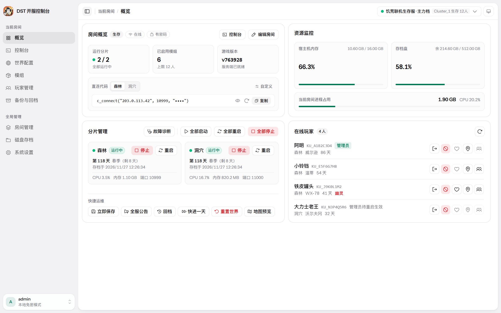
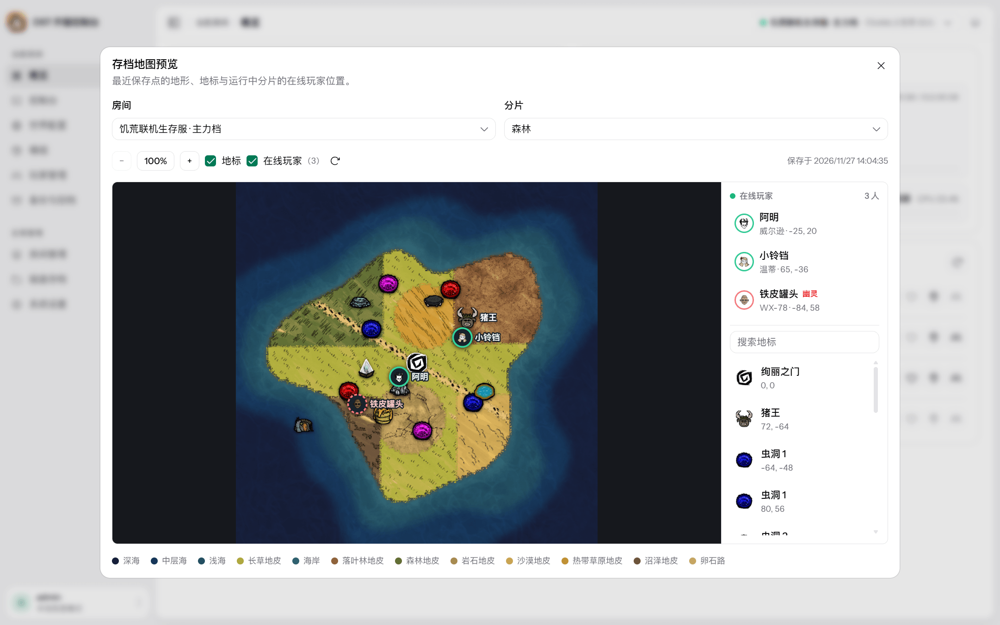
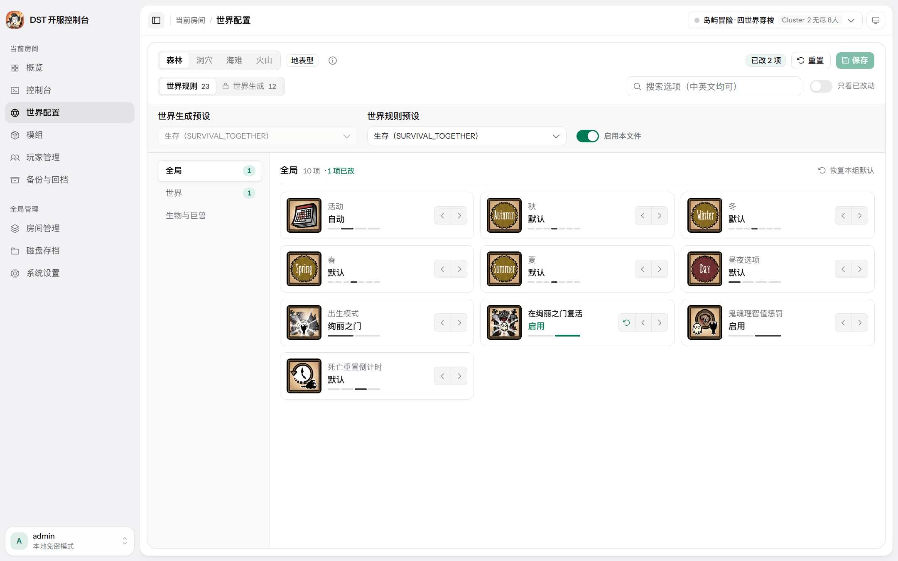
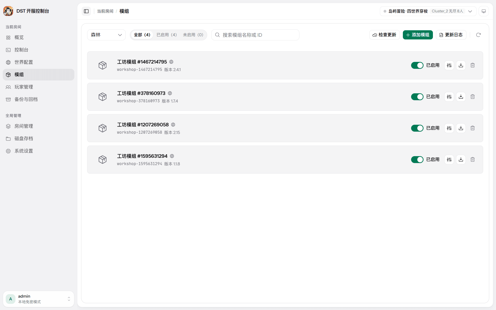

# DSTWin · 自用饥荒联机版开服面板

自用的《饥荒联机版》(Don't Starve Together) 专用服务器 Web 管理面板，后端采用 Go 原生进程管理（`exec.Command` + stdin 管道），前端基于 Vue 3 并通过 `go:embed` 打进单个可执行文件。

- **Windows 原生直跑**：无需 WSL，不依赖 `screen` / `bash` / `ps` / `tail`，直接管理分片进程。
- **Linux / Docker 兼容**：按平台隔离进程组与 SteamCMD，支持单容器 Docker Compose 部署与 Caddy 自动 HTTPS。

> 本项目为个人自用与日常维护编写，实现思路参考了 [dst-management-platform-api (DMP)](https://github.com/miracleEverywhere/dst-management-platform-api)（MIT License），在此致谢。

## 界面预览

### 房间概览与在线玩家
展示当前房间运行分片、直连代码、宿主机资源占用、分片启停、快捷运维（保存 / 公告 / 回档 / 快进 / 重置）及在线玩家快捷操作。



### 存档地图预览与实时玩家位置
解析最近保存点的真实游戏地形贴图、海岸线、地标及虫洞 / 电光三角配对，并实时叠加运行中分片的在线玩家位置与状态，支持搜索与点击定位。



### 多世界可视化配置
按分片（森林 / 洞穴 / 海难 / 火山及自定义世界）可视化编辑 `worldgenoverride.lua`，内置原版与岛屿冒险选项图标，支持搜索、筛选已改项及预设切换。



### 分片模组管理
按分片独立管理 `modoverrides.lua`，支持启用/停用、参数可视化配置、多轮预下载及创意工坊更新检测。



## 核心功能

### 房间与分片运维
- **多房间与多层世界**：单房间可配置任意数量世界分片（地表、洞穴、海难、火山或自定义分片），每分片独立进程与端口，可单独启停或批量操作。
- **进程守护与优雅关服**：`cmd.Wait()` 监听分片退出并自动拉起；停止前自动执行 `c_save()` + `c_shutdown()` 防止丢档；按房间自定义直连地址与密码显示。
- **实时控制台**：独立满屏 SSE 实时日志流，支持分片切换、关键词与告警筛选、快捷指令模板及命令历史。
- **自动化与诊断**：支持定时备份、每日重启、自动更新、故障诊断（结合启动失败日志与模组下载记录定位原因）、房间配置方案导入导出，以及可选 HMAC 签名的 Webhook 事件通知。

### 世界配置与地图预览
- **可视化世界设置**：按分片编辑世界规则与世界生成选项，运行中自动锁定防误改。
- **存档地图预览**：读取真实地形贴图与小地图图标，支持缩放拖拽、地标搜索定位、配对虫洞 / 电光三角标识，以及运行中分片在线玩家的实时位置刷新（每 5 秒轮询，区分存活与幽灵状态）。

### 模组管理
- **分片独立配置 + 全局共享文件**：各分片维护独立 `modoverrides.lua`，同时汇总全部房间启用模组写入 `dedicated_server_mods_setup.lua`。
- **自动复用 Steam 库**：使用本机 Steam 库服务端时直接复用 `steamapps/workshop/content/322330/`，避免重复下载；独立/容器安装则存放于数据目录 `ugc_mods/`。
- **预下载与更新检测**：开服前通过 `-only_update_server_mods` 多轮预下载，避免多分片并发抢写；支持对比创意工坊最新版本并提示有更新的模组。

### 玩家管理与快捷运维
- **在线玩家与准入名单**：支持踢出、封禁、复活、传送、设为管理员，以及按房间维护管理员 / 黑名单 / 白名单（联动预留位）。
- **玩家日志**：后台每 5 秒采集连接与聊天记录，关联 Klei ID / Steam ID / 角色并持久化至 `dst_save/playerlogs/`（单分片上限 50000 条），支持筛选与分页搜索。
- **快捷运维与回档**：概览页一键立即保存（等待落盘回调）、全服公告、快进一天、重置世界（`c_regenerateworld()`）及游戏快照回档（主分片触发、全分片同步重载）。

### 备份、迁移与安全
- **备份与异地同步**：支持手动/定时 ZIP 备份，后台同步到目录、NAS 或 WebDAV，保留份数可控、支持连接测试与失败重试。
- **恢复前检查与全量迁移**：恢复前自动核验压缩包、预览天数/季节与地图并保留原存档；支持导出整套房间、存档、名单与配置方案进行迁移，导入时自动重分配端口。
- **存档管理**：支持导入外部存档整包，盘点磁盘上的存档目录并识别清理孤儿存档。
- **访问控制与资源监控**：登录按客户端 IP 独立限流（连续输错 5 次起指数退避，最高 15 分钟）；实时监控宿主机内存、存档盘空间及 Linux cgroup 内存配额。

> 更多细节见 `docs/`：
> - [配置方案、故障诊断与事件通知](docs/operations-features.md)
> - [完整迁移与存档地图预览](docs/migration-map.md)
> - [异地备份与恢复检查](docs/backup-recovery.md)
> - [岛屿冒险（海难 / 火山）适配说明](docs/island-adventures.md)

## 快速开始

### 环境要求

- **Windows**：Windows 10/11、Go 1.25+、Node.js + pnpm（仅构建前端需要）；服务端会自动探测本机 Steam 库，未安装时可通过面板内 SteamCMD 自动安装（约 4.5GB）。
- **Linux / Docker**：支持 Docker 的 Linux x86_64 主机；裸机运行需 Go 1.25+ 与 32 位运行库（`libc6-i386`、`lib32gcc-s1`、`lib32stdc++6`，供 SteamCMD 使用）。

### Windows 构建与运行

前端构建产物嵌入二进制，修改 `web/` 后需先重新构建前端再编译 Go。仓库根目录可直接运行一键构建脚本：

```powershell
powershell -NoProfile -ExecutionPolicy Bypass -File .\build.ps1
```

或手动构建并启动：

```bash
# 1. 构建前端（产物输出到 web/dist，打包时自动压缩静态图片）
pnpm --dir web install
pnpm --dir web run build

# 2. 编译后端（生成单个 dst-windows.exe）
go build -o dst-windows.exe .

# 3. 运行（默认监听 127.0.0.1:16800）
./dst-windows.exe
```

常用调试命令：

```bash
pnpm --dir web run dev         # 前端开发服务器（:5173，代理 /api 到 127.0.0.1:16800）
pnpm --dir web run dev:mock    # 免后端 Mock UI 预览（含本机真实地图贴图与模拟玩家）
go test ./...                  # 运行 Go 测试
pnpm --dir web test            # 运行前端检查脚本
```

### 命令行参数

| 参数 | 默认值 | 说明 |
|---|---|---|
| `-port` | `16800` | 面板监听端口 |
| `-bind` | `127.0.0.1` | 面板监听地址 |
| `-install` | `false` | 仅安装/更新服务端文件后退出 |
| `-serverdir` | 自动探测 | 指定专用服务器目录（含 `bin/`），也可用 `DST_SERVER_DIR` 或在面板设置页配置 |
| `-arch` | `auto` | 服务端架构：`auto`（优先 64 位）/ `64` / `32` |
| `-data-dir` | exe 同级目录 | 运行数据目录（存档 / 日志 / 模组 / `panel.json` / SteamCMD），也可用 `DST_DATA_DIR` |
| `-username` | `admin` | 登录用户名，也可通过 `DST_PANEL_USERNAME` 或 `panel.json` 配置 |
| `-password` | 空 | 登录密码，也可通过 `DST_PANEL_PASSWORD` 或 `panel.json` 配置 |
| `-v` | `false` | 显示版本号后退出 |

## Linux / Docker 部署

单容器部署（一个面板管理全部房间与分片）：

```bash
cp .env.example .env            # 配置 DST_PANEL_PASSWORD，按需调整 UID/GID 与 DST_SERVER_DIR
mkdir -p ./data && sudo chown -R 1000:1000 ./data
docker compose up -d --build
docker compose logs -f
```

- **公网 HTTPS**：在 `.env` 中设置 `PANEL_DOMAIN` 并运行 `docker compose --profile public up -d --build`，Caddy 会自动签发和续期证书（仅放行 `80` / `443`，`16800` 默认只绑定到宿主 `127.0.0.1`）。
- **持久化与关服**：全部可变数据挂载在 `./data`（容器内 `/data`）；容器启用 `init: true` 与 `stop_grace_period: 2m`，确保各分片有足够时间完成保存后退出；健康检查端点为 `GET /healthz`。
- **网络端口**：采用 bridge + 显式端口段映射（游戏 / 协调 / Steam 端口各映射 100 个，多开房间超出范围时按步长追加）。

### 内存与磁盘参考

DST 专用服务器较吃内存，不足时会在加载阶段被 OOM killer 终止：

| 场景 | 实测参考 |
|---|---|
| 单分片（Master） | 约 0.9～1 GB |
| 双分片（Master + Caves） | 建议 ≥ 3 GB |
| 四分片（含海难 / 火山） | 每分片至少预留 1～1.5 GB |
| 服务端磁盘占用 | 首次下载约 4.5 GB，安装后约 4.3 GB |

## 日常使用备忘

- **存档位置**：默认通过 `-persistent_storage_root` 指向数据目录下的 `dst_save/`，避开 Windows `文档\Klei` 被 OneDrive 重定向的问题。
- **共享模组更新**：复用本机 Steam 库时，更新或删除共享模组前建议先关闭正在使用同一份文件的游戏客户端，避免并发写入冲突。
- **优雅停服**：关服请走面板「停止」，自动保存后再退出；直接强杀进程容易丢档。
- **配置文件编码**：手动编辑 `ini` / `lua` 配置时需保持 **UTF-8 无 BOM**，否则游戏内中文会乱码。
- **SteamCMD 断点续传**：安装/更新服务端偶发网络中断（如 `exit 8` / `App state 0x402`）时，已下载分块会保留，直接重试即可续传。

## 项目结构

```text
main.go                 程序入口：参数解析、路径探测、内嵌静态资源与服务启动
internal/
  server/               跨平台进程管理（Windows / Linux）、守护、崩溃重启与实时玩家查询
  room/                 房间配置、cluster.ini / server.ini / token 与准入名单
  roomprofile/          房间配置方案保存、导入导出与复制
  config/               ini 读写与路径解析
  steamcmd/             Steam 库探测、SteamCMD 调用与服务端安装更新
  workshop/             创意工坊模组信息与下载
  modmgr/               modoverrides.lua 与 dedicated_server_mods_setup.lua 同步
  worldsettings/        worldgenoverride.lua 读写、存档状态与地图解析
  chatlog/              玩家连接与聊天日志采集、归档及查询
  saveimport/           外部存档整包导入与格式转换
  saves/                磁盘存档盘点与孤儿存档清理
  backup/               存档备份与回滚
  backupremote/         异地备份同步（目录 / NAS / WebDAV）与恢复前校验
  migration/            全量迁移包导出、校验与导入
  automation/           定时备份、每日重启与自动更新调度
  diagnostics/          启动与模组下载故障诊断
  notify/               Webhook 事件通知
  hoststats/            宿主机内存/磁盘及 Linux cgroup 配额采样
  panelcfg/             panel.json 配置读写
  web/                  HTTP API、SSE 日志流与前端静态服务
cmd/
  fakeserver/           测试用模拟服务端
  verify/               Windows 进程生命周期验证工具
web/                    Vue 3 + Tailwind CSS v4 + Vite 前端源码
docs/                   功能文档、技术说明与界面截图
```

## 致谢与许可

- 参考与致谢：[dst-management-platform-api (DMP)](https://github.com/miracleEverywhere/dst-management-platform-api)（Author: [Miracle](https://github.com/miracleEverywhere), MIT License）
- 开源协议：[MIT License](LICENSE)
